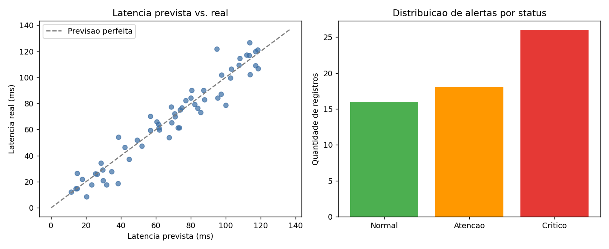

# Aurora Siger: SCIC (Sistema de Comunicação Inteligente da Colônia)

Sistema em terminal que organiza, analisa e prioriza dados simulados de comunicação e operação da colônia marciana **Aurora Siger**, utilizando Pandas/NumPy, cálculo de erro, regressão linear, heap, trie, bases numéricas e eletricidade básica.



---

## Organização

    fase6/
    ├── codigo_fonte.py                      # ponto de entrada do sistema
    ├── dados_aurora_siger.csv               # base simulada (60 registros, 10 módulos)
    ├── arquivos_auxiliares/
    │   ├── gerar_dados.py                   # gera o CSV (seed fixo = 42)
    │   └── gerar_graficos.py                # gera o gráfico de apoio
    ├── graficos_ou_imagens/
    │   └── analise_latencia_status.png      # latência prevista vs. real e alertas por status
    ├── relatorio_tecnico.md                 # relatório técnico completo
    └── link_video.txt                       # link do vídeo de apresentação

---

## O que o sistema faz

- Carrega os dados de comunicação da colônia a partir de um **CSV com Pandas**
- Permite cadastrar e consultar registros pelo terminal
- Calcula, para cada registro:
  - Erro absoluto e erro relativo entre a latência prevista e a latência real
  - Potência elétrica do módulo (`P = V × I`)
- Treina um modelo de **regressão linear** para prever a latência e avalia com MAE, MSE, RMSE e R², comparando com um baseline simples
- Prioriza os alertas mais urgentes com um **heap**
- Busca módulos e códigos de sensores por prefixo com uma **trie**
- Converte códigos de sensores entre decimal, binário e hexadecimal
- Calcula potência e resistência pela **Lei de Ohm**
- Exibe uma análise final com o resumo da base

---

## Estruturas de Dados Utilizadas

| Estrutura | Aplicação | Complexidade |
|---|---|---|
| **Max-heap** (classe `FilaPrioridade`) | Selecionar o alerta mais urgente | O(log n) para inserir e extrair |
| **Trie** (classe `Trie`) | Buscar módulos e sensores por prefixo | O(k), sendo k o tamanho do prefixo |
| `DataFrame` (Pandas) | Organização e cálculo vetorizado dos registros | |

O heap foi implementado manualmente em vetor, com `_subir` (heapify-up) e `_descer` (heapify-down), sem depender da biblioteca `heapq`.

---

## Modelagem Matemática

Erros numéricos entre a latência prevista e a observada:

    erro_absoluto = |latencia_real − latencia_prevista|
    erro_relativo = erro_absoluto / latencia_real × 100

Prioridade de cada alerta no heap:

    prioridade = criticidade × 10 + atraso × 0,5 + peso_do_risco + tempo_desde_registro × 0,05

Eletricidade básica aplicada aos módulos:

    P = V × I
    R = V / I

A regressão linear usa `criticidade`, `tensao_v`, `corrente_a` e `tempo_desde_registro_min` para prever a latência real, com divisão treino/teste de 75%/25%. Os resultados e a interpretação das métricas estão no `relatorio_tecnico.md`.

---

## Menu do Sistema

```
 1. Carregar dados
 2. Cadastrar novo registro
 3. Consultar registros
 4. Indicadores e erros numericos
 5. Previsao e avaliacao do modelo
 6. Priorizar alertas (heap)
 7. Buscar por prefixo (trie)
 8. Bases numericas e eletricidade
 9. Analise final
 0. Sair
```

---

## Como Rodar

Requer Python 3.9+ e as bibliotecas abaixo:

    pip install pandas numpy scikit-learn

Execute a partir de dentro da pasta `fase6/`, porque o caminho do CSV é relativo:

    python codigo_fonte.py

Comece pela opção **1** (carregar dados) antes de usar as demais.

Para gerar os dados e o gráfico de novo (o gráfico precisa também de `matplotlib`):

    python arquivos_auxiliares/gerar_dados.py
    python arquivos_auxiliares/gerar_graficos.py

---

## Observações

- Os dados são 100% simulados, sem uso de sensores físicos, APIs externas ou hardware real
- Registros cadastrados pelo menu valem apenas para a sessão atual, não são salvos de volta no CSV
