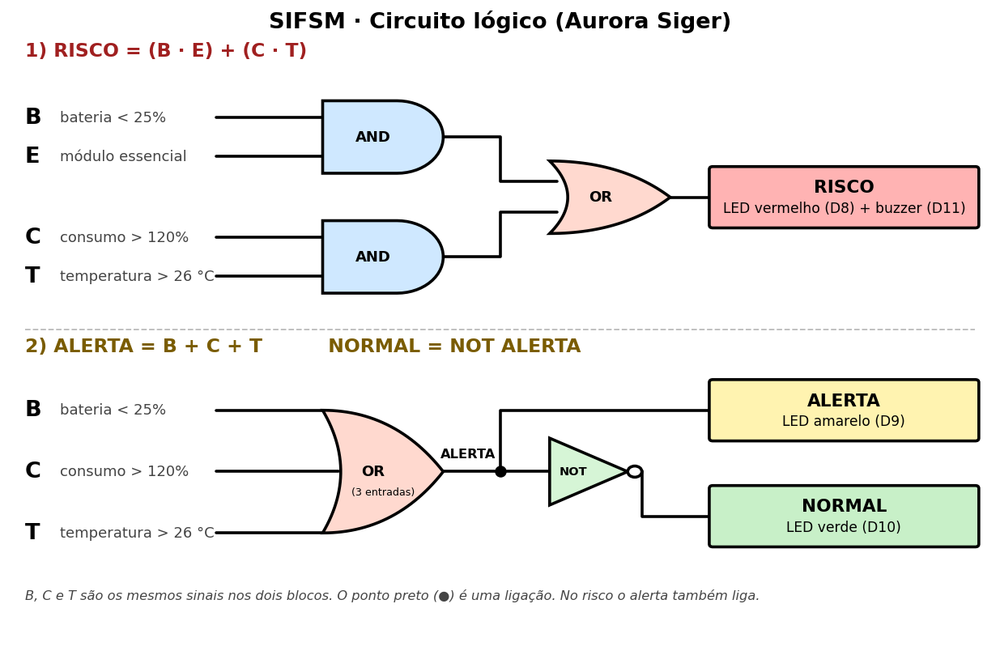
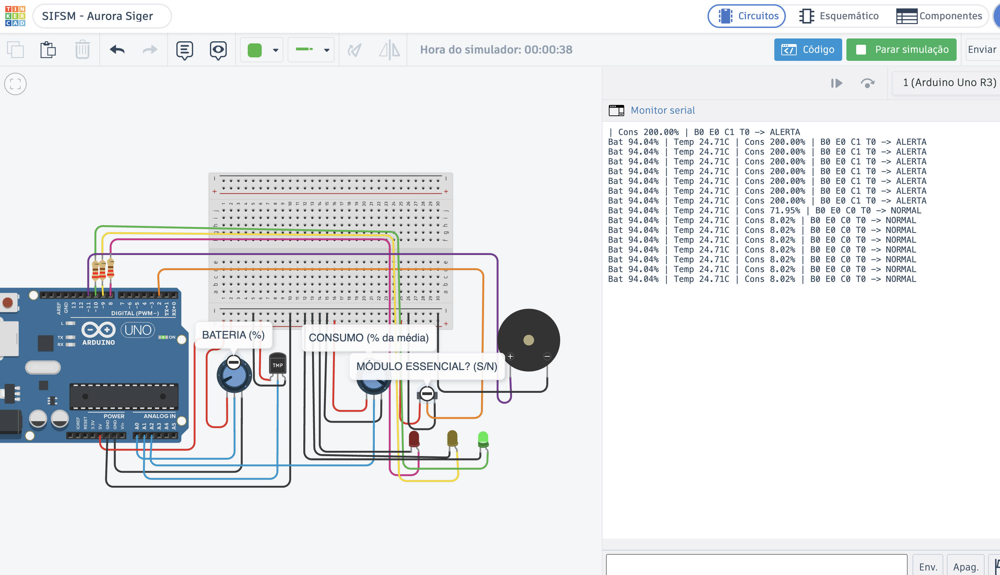
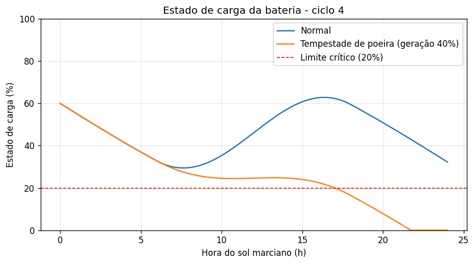
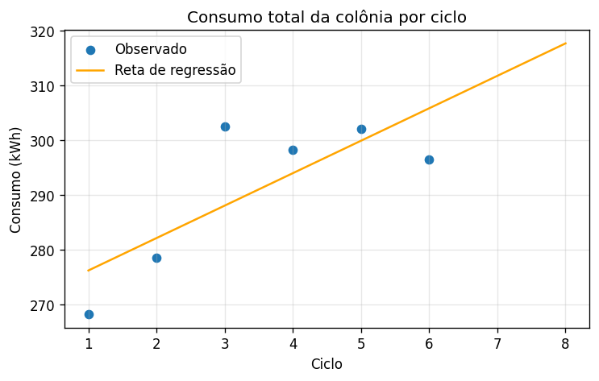

<div align="center">

# Sistema Integrado de Futuro Sustentável em Marte
**Colônia Aurora Siger · Fase 7 — A Aurora Constrói os Alicerces de um Futuro Sustentável em Marte**


</div>

---

## O que é o SIFSM?

O SIFSM é o protótipo que apoia a autonomia energética da Colônia Aurora Siger. Ele guarda as leituras dos **8 módulos da colônia** (consumo, geração, bateria, temperatura e ocupação) em um banco SQLite, classifica o risco com **lógica booleana**, organiza os alertas com **estruturas de dados**, **simula a bateria** por integração numérica, **prevê o consumo** com regressão linear e usa **agentes de IA com guardrails** para sugerir ações. A mesma lógica foi montada como circuito no **Tinkercad (Arduino)**.

> Todos os dados são **simulados**: foram gerados por nós e não representam medições reais. A capacidade da bateria, os limites de alerta e o grafo de dependências entre módulos são hipóteses do projeto.

---

## Equipe

| Nome | RM | Turma |
|---|---|---|
| Isabelle Caroline de Camargo Francisco | 572096 | 1CCOB |
| Matheus Lyncoln Souza Dias | 570765 | 1CCOB |
| Mirela Aparecida Bispo Miguel | 570830 | 1CCOB |
| Rodrigo Abrantes Mizerani | 571808 | 1CCOB |
| Vinícius Valiati | 568674 | 1CCOC |


---

## Início rápido

```bash
# Instale as dependências (uma vez):
pip install -r requirements.txt

# Execute o sistema:
python codigo_fonte.py

# Windows
py codigo_fonte.py
```

Na primeira execução o sistema cria `aurora_siger.db` a partir de `script_banco.sql` e `dados_aurora_siger.csv`. Para recomeçar do zero, apague `aurora_siger.db`.

**Configuração da IA (menu 7):** os agentes usam a API do Gemini. Para ativá-la, crie na raiz do projeto um arquivo `.env` (modelo em `.env.example`) com a linha `GEMINI_API_KEY=<sua chave>`; a chave gratuita é gerada em [aistudio.google.com/app/api-keys](https://aistudio.google.com/app/api-keys). Sem chave ou sem internet, o sistema continua totalmente funcional: o menu 7 executa o mesmo fluxo de agentes em **modo simulado** e informa isso na tela. As demais opções não dependem de internet nem de chave.

---

## Menu do sistema

```
╔══════════════════════════════════════════════════════╗
║          SIFSM — Colônia Aurora Siger                ║
╠══════════════════════════════════════════════════════╣
║  1. Registros da colônia (CRUD)                      ║
║  2. Regras de decisão            [lógica booleana]   ║
║  3. Estruturas de dados    [heap, pilha, hash, grafo]║
║  4. Simulação da bateria        [integração]         ║
║  5. Modelo linear                [regressão]         ║
║  6. Circuito lógico / Arduino    [Tinkercad]         ║
║  7. Agentes de IA e guardrails   [Gemini]            ║
║  8. Arquitetura e desempenho     [CPU/GPU/NPU]       ║
║  9. Analisar sustentabilidade da colônia             ║
║  0. Sair                                             ║
╚══════════════════════════════════════════════════════╝
```

---

## A base de dados

O arquivo `dados_aurora_siger.csv` traz **48 registros simulados**: os 8 módulos da colônia (MOD-EN-001 a MOD-CM-008), acompanhados ao longo de 6 ciclos de operação (1 ciclo = 1 sol de 24 h). Ele é carregado no banco SQLite pela estrutura definida em `script_banco.sql`.

| Coluna | Descrição |
|--------|-----------|
| `codigo_modulo` / `modulo` / `tipo` | Código, nome e tipo do módulo (ex.: MOD-EN-001, energia) |
| `ciclo` | Ciclo de operação (1 a 6) |
| `consumo_kwh` / `geracao_kwh` | Energia consumida e gerada no ciclo, em kWh (só o módulo de energia gera) |
| `bateria_pct` | Nível da bateria local, de 0 a 100 |
| `temperatura_c` / `ocupacao_pct` | Temperatura (°C) e ocupação do módulo (%) |
| `status` | ativo, manutenção ou alerta |
| `prioridade_alerta` | Urgência do alerta, de 1 (baixa) a 5 (crítica) |
| `mensagem` | Resumo do alerta |

**Regras do banco:** `CHECK` impede bateria fora de 0–100, status inválido e consumo negativo; `UNIQUE (codigo_modulo, ciclo)` impede dois registros do mesmo módulo no mesmo ciclo.

**Origem dos dados:** gerados por script com valores aleatórios (semente fixa) e eventos inseridos de propósito: picos de consumo da mineração e da agricultura, queda de geração no ciclo 4 e baterias baixas nos ciclos 5 e 6.

---

## Funcionalidades

| Opção | O que faz | Arquivo |
|-------|-----------|---------|
| 1 | Cadastrar, listar (filtros), alterar e excluir registros, com tratamento de erros | `modulos/dados.py` |
| 2 | Regra booleana de risco, tabela verdade e circuito em ASCII | `modulos/regras.py` |
| 3 | Fila de alertas (heap), histórico (pilha), busca (hash) e impacto de falha (grafo) | `modulos/estruturas.py` |
| 4 | Estado de carga da bateria por integral numérica, com cenário de tempestade de poeira e gráfico | `simulacao_computacional.py` |
| 5 | Análise exploratória, regressão linear simples e múltipla com métricas | `modulos/modelo.py` |
| 6 | Simulação do circuito lógico (cenários com LEDs e buzzer); indica o diagrama de portas e o link do Tinkercad | `modulos/hardware.py` |
| 7 | Três agentes de IA (Gemini) com ferramentas, handoffs, guardrails e tracing | `modulos/agentes.py`, `modulos/llm.py` |
| 8 | Benchmark laço × NumPy e relação com CPU, GPU, NPU, memória e movimentação de dados | `modulos/arquitetura.py` |
| 9 | Análise final: situação, fila, simulação, tendência, recomendação e limitações | `modulos/analise.py` |

---

## CRUD e tratamento de erros

Toda escrita passa por uma função única com `try/except/else/finally`: o `except` separa `IntegrityError` (o banco recusou o dado) dos demais erros do banco, o `else` confirma a operação e o `finally` **sempre** fecha a conexão. As entradas do usuário são convertidas com `ValueError` tratado, e as consultas usam parâmetros `?` (o nome do campo a alterar é conferido contra uma lista fixa, evitando SQL injection).

| Teste | Resultado |
|-------|-----------|
| Cadastrar com bateria 150% | Recusado pelo banco (`CHECK constraint failed`) |
| Alterar bateria para `abc` | `ValueError` tratado: mostra o erro e volta ao menu, sem alterar nada |
| Alterar bateria para `12,5` | Aceito (a vírgula vira ponto) |
| Alterar status para `qualquer` | Recusado: só vale ativo, manutenção ou alerta |
| Alterar ou excluir o id 999 | "Nenhum registro com id 999" |
| Excluir respondendo `n` | Cancelado |

---

## Lógica booleana e circuito

**Variáveis:** **B** = bateria < 25%; **E** = módulo essencial (energia, suporte à vida ou habitação); **C** = consumo > 120% da média do próprio módulo; **T** = temperatura > 26 °C.

```
RISCO  = (B AND E) OR (C AND T)        →  LED vermelho + buzzer
ALERTA = B OR C OR T                   →  LED amarelo
NORMAL = NOT ALERTA                    →  LED verde
```

| Resultado nos 48 registros | Quantidade |
|----------------------------|------------|
| Em RISCO | 2 (suporte à vida no ciclo 6 e mineração no ciclo 5) |
| Em ALERTA | 3 |
| Normais | 43 |

**Circuito lógico (portas):** `circuito_logico.png` mostra a expressão em portas AND, OR e NOT, em dois blocos: (1) o risco, com duas ANDs e uma OR; (2) o alerta, com uma OR de 3 entradas, e o normal, com uma NOT. B, C e T são os mesmos sinais nos dois blocos.



**Tinkercad / Arduino:** O circuito no Tinkercad (Arduino Uno) aplica a mesma lógica, com potenciômetros (bateria em A0 e consumo em A2), sensor TMP36 (temperatura em A1), chave (módulo essencial em D2), três LEDs com resistor de 220 Ω (D8, D9, D10) e um buzzer (D11). O projeto pode ser aberto em **[Tinkercad · SIFSM - Aurora Siger](https://www.tinkercad.com/things/bbS7ZRjeOWD-sifsm-aurora-siger?sharecode=pPgMVw7MAiT3Lw-rcLuv6O4d3PGObGuzf_Yof2oN40w)** (o mesmo link está em `link_tinkercad.txt`), o código do Arduino em `tinkercad/arduino_sifsm.ino` (o mesmo que está na aba Código do Tinkercad) e o esquemático exportado em `graficos_ou_imagens/esquematico_tinkercad.pdf`.



O Monitor Serial mostra, a cada meio segundo, os valores lidos, as variáveis B, E, C, T e a decisão (`NORMAL`, `ALERTA` ou `RISCO`).

| Pino | Componente | Variável / função |
|------|-----------|-------------------|
| A0 | Potenciômetro (0–100%) | B, bateria < 25% |
| A1 | Sensor TMP36 | T, temperatura > 26 °C |
| A2 | Potenciômetro (0–200% da média) | C, consumo > 120% |
| D2 | Chave deslizante | E, módulo essencial |
| D8 | LED vermelho | RISCO |
| D9 | LED amarelo | ALERTA |
| D10 | LED verde | NORMAL |
| D11 | Buzzer piezo | RISCO |

| Cenário simulado | B | E | C | T | Verde | Amarelo | Vermelho | Buzzer |
|------------------|---|---|---|---|-------|---------|----------|--------|
| Operação normal | 0 | 0 | 0 | 0 | 1 | 0 | 0 | 0 |
| Temperatura alta isolada | 0 | 0 | 0 | 1 | 0 | 1 | 0 | 0 |
| Bateria baixa, módulo comum | 1 | 0 | 0 | 0 | 0 | 1 | 0 | 0 |
| Bateria baixa, módulo essencial | 1 | 1 | 0 | 0 | 0 | 1 | 1 | 1 |
| Consumo alto + temperatura alta | 0 | 0 | 1 | 1 | 0 | 1 | 1 | 1 |

---

## Estruturas de dados

| Estrutura | Uso na colônia | Por que essa |
|-----------|----------------|--------------|
| **Heap** (`heapq`) | Fila de alertas por prioridade (o RISCO soma +1) | O mais urgente sai primeiro, sem reordenar a lista toda |
| **Pilha** (`list`) | Histórico das ações do CRUD | A última ação aparece primeiro (LIFO) |
| **Tabela hash** (`dict`) | Índice de módulos pelo código | Busca direta pela chave, sem varrer os 48 registros |
| **Grafo + BFS** | Dependências entre módulos | Mostra quem para quando um módulo falha |

| Ordem | Módulo | Ciclo | Prioridade |
|-------|--------|-------|------------|
| 1º | MOD-SV-002 Suporte à Vida | 6 | 6 |
| 2º | MOD-MN-005 Mineração ISRU | 5 | 5 |
| 3º | MOD-CM-008 Comunicação | 6 | 3 |

Se a **mineração** falhar, ficam afetados logística, agricultura e suporte à vida (3 módulos). Se a **comunicação** falhar, só os sensores científicos.

---

## Simulação da bateria

O estado de carga é a **integral do saldo de potência** ao longo do ciclo:

```
SoC(t) = SoC0 + (1 / C) · ∫ [ g(s) − c(s) ] ds
```

`g(t)` é a geração solar (meia senoide entre 6 h e 18 h, com `P_max = E_dia · π / 24`), `c(t)` é o consumo (média do ciclo com variação de ±15%), a capacidade é C = 300 kWh e o SoC inicial é 60%. A integral é calculada pela **regra do trapézio** e conferida com o valor exato: a diferença é menor que 0,01 kWh.

| Ciclo | Cenário | SoC final | SoC mínimo | Horas abaixo de 20% |
|-------|---------|-----------|------------|---------------------|
| 1 | Normal | 65,9% | 33,5% | 0,0 h |
| 1 | Tempestade de poeira (geração 40%) | 8,7% | 8,7% | 2,7 h |
| 4 | Normal | 32,3% | 29,5% | 0,0 h |
| 4 | Tempestade de poeira (geração 40%) | 0,0% | 0,0% | 7,0 h |



---

## Modelo linear

**Análise exploratória:** correlação de Pearson com o consumo: bateria −0,41, temperatura 0,21, ocupação 0,14, ciclo 0,08.

**Regressão simples (consumo total da colônia × ciclo):** `consumo = 270,2 + 5,93 · ciclo` (R² = 0,61). A cada ciclo o consumo total sobe cerca de 5,9 kWh. A previsão para o ciclo 7 é de **311,7 kWh**, acima da geração média atual (284,2 kWh).



**Regressão múltipla (consumo do módulo × tipo, ciclo, temperatura e ocupação):** 75% treino (36 registros) e 25% teste (12 registros).

| Previsão | MAE | RMSE | R² |
|----------|-----|------|----|
| Nosso modelo | 1,57 | 1,80 | 0,98 |
| Chute pela média (baseline) | 12,48 | 14,40 | −0,07 |

- O modelo erra cerca de 8 vezes menos que o chute pela média.
- Os maiores coeficientes vêm do **tipo do módulo** (referência: agricultura): comunicação −35,2, laboratório −32,1, mineração +13,5. A temperatura soma 0,65 kWh por °C.
- **Cuidado:** o R² alto vem principalmente do tipo do módulo, e são só 12 registros de teste com dados simulados. É uma demonstração do método, não uma previsão confiável.

---

## Agentes de IA e guardrails

Três agentes (Gemini, via `urllib`), cada um com um papel e uma lista **permitida** de ferramentas. O modelo decide quando chamá-las (function calling) e o nosso código executa.

```
Pedido → [guardrail de entrada] → MONITOR ──handoff──▶ ANALISTA ──handoff──▶ PLANEJADOR
                                                                              │
                              HUMANO decide ◀── [guardrail de saída] ◀────────┘
```

| Agente | Ferramentas | Papel |
|--------|-------------|-------|
| Monitor | `listar_alertas` | Resume quem está em risco ou alerta |
| Analista | `simular_cenario` | Simula a bateria (normal e tempestade) |
| Planejador | `impacto_falha`, `buscar_procedimento` | Recomendação com procedimentos (RAG simples, cita PROC-xx) |

**Guardrails:** bloqueio de pedidos como "excluir registros" e de dados pessoais; cada agente só enxerga as suas ferramentas (qualquer outra é recusada e registrada); argumentos do modelo são validados; nenhuma ferramenta altera o banco; toda saída é uma **sugestão** que exige aprovação humana. O **tracing** registra cada passo (menu 7, opção 3).

**Fallback:** sem chave ou sem internet, o sistema usa o fluxo simulado (mesmas ferramentas, sem modelo) e avisa `[simulado]`. **Privacidade:** só dados simulados e agregados de módulos são enviados à API, nada de pessoas.

---

## Arquitetura e desempenho

O benchmark do menu 8 calcula 2 milhões de pontos da curva solar de duas formas:

| Método | Tempo |
|--------|-------|
| Laço em Python | 0,376 s |
| NumPy vetorizado | 0,012 s (≈ 31× mais rápido, mesmo resultado) |

Os tempos mudam de máquina para máquina. O ganho vem de aplicar a mesma operação a vários dados de uma vez (SIMD). A **CPU** roda o menu, o banco e as regras; uma **GPU** compensaria para simular centenas de cenários independentes; **NPU/TPU** rodariam modelos de IA na colônia com pouca energia, sem depender da Terra (atraso de 3 a 22 minutos). O gargalo do protótipo é **mover dados** (banco → DataFrame → arrays), não calcular, e para este problema um modelo linear pequeno em CPU basta e gasta muito menos energia que uma rede grande.

---

## Análise final

A opção 9 reúne tudo: lê o banco, aplica a regra booleana, ordena os alertas com o heap, simula o ciclo mais crítico (o de menor SoC final, o mesmo usado pelos agentes), estima a tendência do consumo e gera uma recomendação: ampliar geração ou armazenamento (previsão de 311,7 kWh no ciclo 7 contra 284,2 kWh de geração), inspecionar MOD-MN-005 e MOD-SV-002 e preparar o modo econômico em tempestades.

**Limitações:** base simulada com 6 ciclos; a regressão por ciclo usa só 6 pontos; a regra compara com a média do módulo, que já inclui os próprios picos; as respostas do modelo de IA variam e passam por aprovação humana.

---

## Estrutura de arquivos

```
SIFSM-Aurora-Siger
├── codigo_fonte.py               # sistema principal: execute este arquivo
├── simulacao_computacional.py    # simulação do estado de carga da bateria
├── script_banco.sql              # criação da tabela
├── dados_aurora_siger.csv        # base de dados simulada
├── circuito_logico.png           # diagrama de portas do circuito lógico
├── link_tinkercad.txt            # link do projeto no Tinkercad (circuito Arduino)
├── relatorio_tecnico.md          # relatório técnico do projeto
├── link_video.txt                # link do vídeo (YouTube · Não listado)
├── requirements.txt              # dependências
├── .env.example                  # modelo do arquivo da chave da API
├── .gitignore                    # arquivos ignorados pelo Git
├── modulos/                      # módulos de apoio, um por assunto
│   ├── dados.py                  # banco SQLite, carga do CSV, CRUD e tratamento de erros
│   ├── regras.py                 # lógica booleana, tabela verdade e circuito em ASCII
│   ├── estruturas.py             # heap, pilha, hash e grafo
│   ├── modelo.py                 # regressão linear simples e múltipla
│   ├── hardware.py               # simulação do circuito lógico (cenários)
│   ├── agentes.py                # agentes de IA, ferramentas e guardrails
│   ├── llm.py                    # cliente da API do Gemini (function calling)
│   ├── arquitetura.py            # benchmark e relação com a arquitetura computacional
│   └── analise.py                # análise final de sustentabilidade
├── tinkercad/
│   └── arduino_sifsm.ino         # código do Arduino usado no circuito do Tinkercad
├── graficos_ou_imagens/          # gráficos e evidências
│   ├── simulacao_soc_ciclo1.png
│   ├── simulacao_soc_ciclo4.png
│   ├── regressao_simples.png
│   ├── tinkercad_simulacao.png   # print da simulação com o Monitor Serial
│   └── esquematico_tinkercad.pdf # esquemático exportado do Tinkercad
└── docs/
    └── roteiro_video.md          # roteiro do vídeo e do pitch (uso interno da equipe)
```

> Execute sempre `python codigo_fonte.py` na raiz do projeto: ele localiza sozinho a pasta `modulos/`. O banco `aurora_siger.db` é criado automaticamente na primeira execução. Os gráficos são gerados em `graficos_ou_imagens/` pelas opções 4 e 5. O `circuito_logico.png` é uma imagem pronta do diagrama de portas, e o PDF do esquemático foi exportado do Tinkercad.

---

## Dependências

| Biblioteca | Uso |
|------------|-----|
| `pandas` | Leitura da base e análise exploratória |
| `numpy` | Cálculos numéricos e integração |
| `matplotlib` | Gráficos da simulação e da regressão |
| `scikit-learn` | Regressão linear, divisão treino/teste e métricas |

`sqlite3`, `csv`, `heapq` e `urllib` (chamada ao Gemini) são da biblioteca padrão do Python. A IA usa a API do Gemini, que exige uma chave gratuita (ver Início rápido); sem ela, o sistema continua funcionando em modo simulado.

---

## Uso de IA no desenvolvimento

A equipe contou com o apoio do Claude Code (Anthropic) na execução de algumas etapas do código. Todas as decisões do projeto e a revisão do que foi gerado foram feitas pelo grupo.

---

<div align="center">
<sub>FIAP · Fase 7 — Futuro Sustentável em Marte · Colônia Aurora Siger</sub>
</div>
